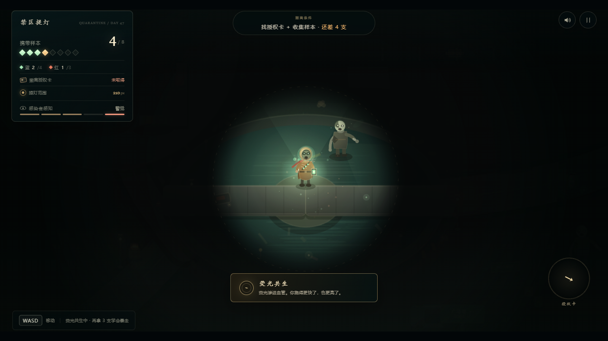
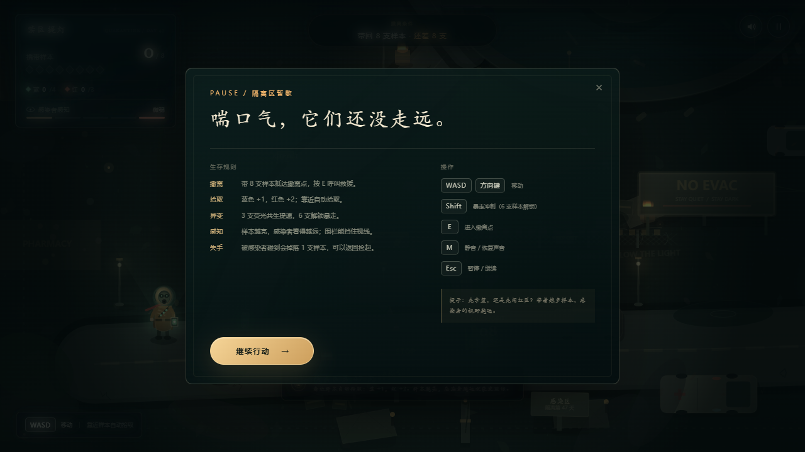

# 拾光者 · 感染区

> **你捡起的每一束光，都会把尸群引来。**

一个以“收集”为核心的丧尸末日题材单页互动作品。你是一只提着灯的拾光者，在封锁区里收集荧光抗体样本；样本让你跑得更快、变得更强，也让感染者从更远处发现你。

**目标：带 8 支样本抵达东北角的 H 停机坪，按 `E` 呼叫救援。**

[](https://nanci101.github.io/lumenfall/)
[](poster/poster.png)

- **在线试玩：** <https://nanci101.github.io/lumenfall/>
- **GitHub 仓库：** <https://github.com/nanci101/lumenfall>
- **可打印海报：** [poster/poster.pdf](poster/poster.pdf)
- **离线单文件：** [standalone.html](standalone.html)

> 如果所在网络打不开 `github.io`：直接双击 / 分发 `standalone.html` 即可离线游玩；也可以在项目目录运行 `python -m http.server 5080`，用本机地址进入。

推荐使用桌面浏览器；手机横屏也可以玩，右下“暴走”按钮在 6 支样本后解锁。

## 为什么是丧尸，为什么不是三关

示例《小猫寻鱼》的价值在于一套很轻的教学骨架：单页、无外部素材、计分目标、危险物、路线选择、触屏、GitHub Pages 发布。这个作品保留了这套骨架最有用的部分，但没有做三关换皮。

我把三关压缩成**一张连续、可自由探索的隔离区地图**：南侧公路、隔离病房、水池断桥、广播塔、撤离停机坪。收集、躲避和选路线同时发生；危险不是被关在某一关里，而是跟着你携带的光走。

## 玩法

- **蓝色抗体 `+1` / 红色活性样本 `+2`**
- **全场只有 4 蓝 + 3 红**；想凑够 8 支，至少要进入**两个红色隔离区**
- 收集会改变角色：
  - 3 支：**荧光共生**，移动更快，外观出现荧光血管与短菌丝
  - 6 支：**临界暴走**，解锁 `Shift` 冲刺
  - 8 支：信号共振，撤离点的绿色光柱亮起
- **核心规则：样本越亮，感染者的感知范围越远。** 被扑中会掉落 1 支样本，可返回捡起。
- 围栏、车辆、推车、墙体会截断感染者的视锥；你可以绕路、躲藏，或用暴走冲刺甩开它们。

| 操作 | 键盘 | 触屏 |
| --- | --- | --- |
| 移动 | `WASD` / 方向键 | 左下方向键 |
| 暴走 | `Shift`（6 支解锁） | 右下按钮 |
| 进入撤离点 | `E` | 靠近后点按钮 |
| 暂停 | `Esc` / `P` | 右上暂停 |
| 静音 | `M` | 右上声音 |

## 截图

| 标题页 | 游戏实机 |
| --- | --- |
|  |  |

| 被感染者发现 | 撤离成功 |
| --- | --- |
|  |  |

| 暂停规则页 | 手机横屏 |
| --- | --- |
|  |  |

A2 海报：

[](poster/poster.pdf)

## 设计要点

1. **收集物不是分数，而是会改变状态的光。** 你会为了第 3 支、第 6 支的能力主动冒险，也会因为太亮而后悔。
2. **高价值样本在危险区。** 红色 +2 分布在病房、水池岛、广播塔；至少选两个，路线自然会不同。
3. **同一张地图上做选择。** 先去病房还是先去水池？先拿红还是先扫蓝？什么时候停下来捡回掉落的样本？这些都由玩家决定。
4. **失败可恢复。** 被扑中只掉 1 支样本，可以回去捡；不会死档，更适合课堂试玩。

更完整的设计说明见 [DESIGN.md](DESIGN.md)，试玩与修复记录见 [PLAYTEST.md](PLAYTEST.md)。

## 项目结构

```text
lumenfall/
├─ index.html                 # 进入感染区
├─ style.css                  # 标题、HUD、弹层、触屏界面
├─ game.js                    # Canvas 2D 游戏逻辑与画面生成
├─ standalone.html            # 离线单文件版（CSS/JS 已内联）
├─ poster/
│  ├─ poster.png              # A2 海报（2480 × 3508）
│  ├─ poster.pdf              # 可打印 PDF
│  ├─ poster.html             # 海报源文件
│  ├─ qr.png                  # 在线试玩二维码
│  └─ hero-action.png         # 游戏实机主视觉
├─ playtest/                  # 试玩截图
├─ DESIGN.md
└─ PLAYTEST.md
```

## 本地运行

```bash
# 在作品目录中
python -m http.server 5077
```

打开 <http://127.0.0.1:5077/>。也可以直接双击 `standalone.html`；不需要服务器、不需要安装依赖。

## 技术

- 纯原生 HTML / CSS / JavaScript，无任何第三方图片、字体或音频依赖。
- Canvas 2D 实时绘制，Web Audio 合成音效。
- 响应式 16:9 舞台与触屏方向键；桌面 / 手机均可玩。
- GitHub Pages 静态部署。

## 关于示例

随任务提供的示例《小猫寻鱼》被我作为**结构与发布方式参考**：单页、无素材依赖、HUD、触屏、GitHub Pages。关卡结构、丧尸题材、收集后异变、光影感知规则与全部画面均为这个作品重新设计。

## 作者与状态

- 设计与代码：nanci101
- 类型：单人 · 收集 / 潜行 · 约 4 分钟
- 状态：已完成并部署 GitHub Pages；试玩修复记录见 [PLAYTEST.md](PLAYTEST.md)
