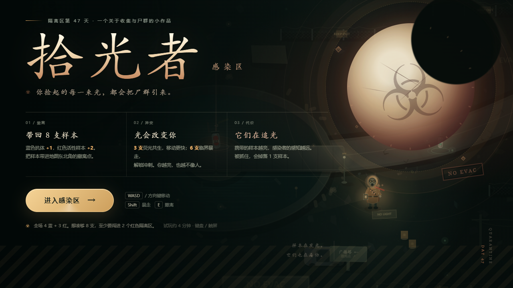
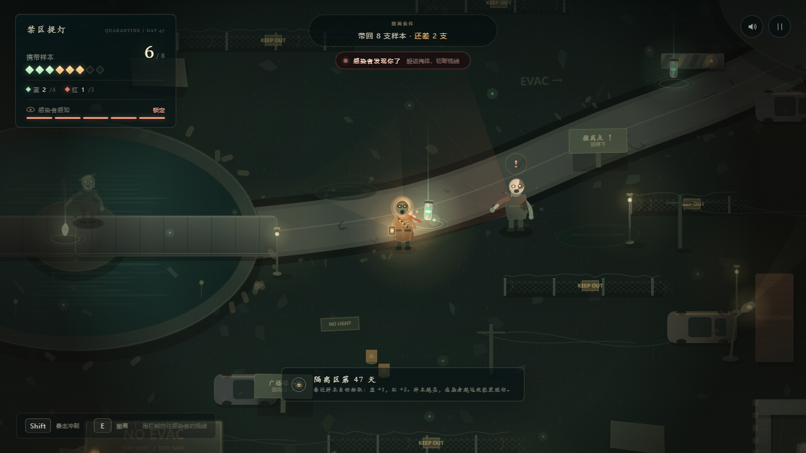
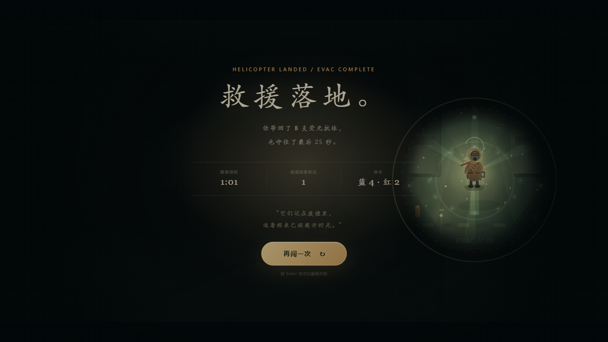
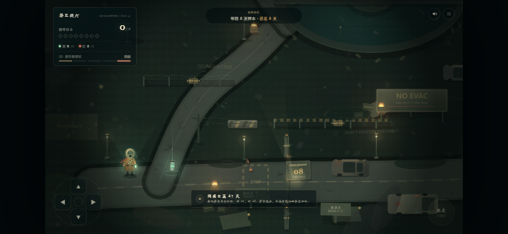
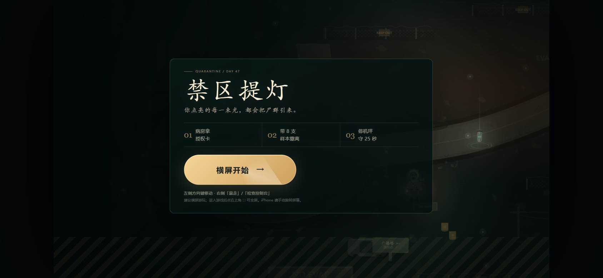
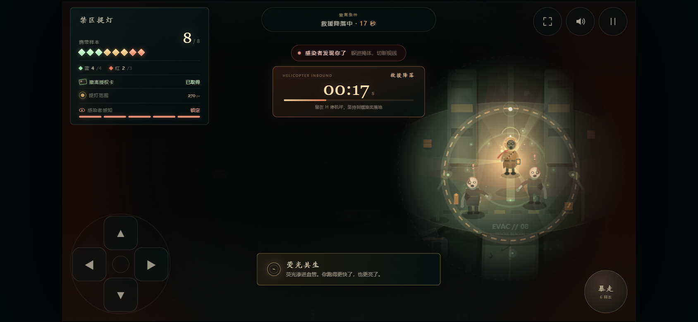
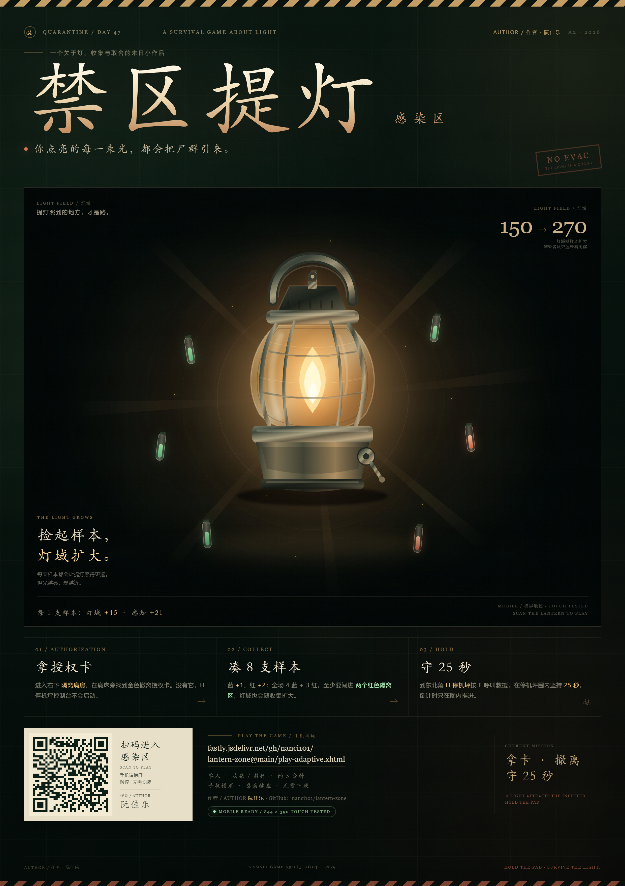

# 禁区提灯 · 感染区

> **你点亮的每一束光，都会把尸群引来。**

一个以“收集”为核心的丧尸末日题材单页互动作品。你是一个提着灯的幸存者，在几乎全黑的封锁区里收集荧光抗体样本。提灯只照亮身边一小圈；每捡起一支样本，灯域扩大，你能看得更远，感染者也会从更远处看见你。

**目标：先在病房拿到撤离授权卡，带 8 支样本抵达东北角的 H 停机坪，在停机坪坚持 25 秒等直升机落地。**

[](https://fastly.jsdelivr.net/gh/nanci101/lantern-zone@main/play-adaptive.xhtml)
[](poster/poster.png)

- **手机试玩（海报二维码同址，单文件 XHTML）：** <https://fastly.jsdelivr.net/gh/nanci101/lantern-zone@main/play-adaptive.xhtml>
- **备用 CDN（cdn.jsdelivr 有时不可达）：** <https://gcore.jsdelivr.net/gh/nanci101/lantern-zone@main/play-adaptive.xhtml>
- **GitHub Pages：** <https://nanci101.github.io/lantern-zone/>
- **GitHub 仓库：** <https://github.com/nanci101/lantern-zone>
- **可打印海报：** [poster/poster.pdf](poster/poster.pdf)
- **离线单文件：** [standalone.html](standalone.html)

> 手机请横屏，点“横屏开始”。左侧圆盘拖动移动，右侧“暴走”/“检查控制台”。进入游戏后，右上角 `⛶` 可全屏。
>
> 海报二维码直接指向 fastly.jsdelivr.net 的 XHTML 单文件版，不经过短链跳转；如果所在网络打不开 `github.io`，用手机试玩链接；也可以直接双击 / 分发 `standalone.html` 离线游玩。

**作者：** 阮佳乐 · **类型：** 单人收集 / 潜行 · **时长：** 约 5 分钟

## 为什么是丧尸，为什么不是三关

示例《小猫寻鱼》的价值在于一套很轻的教学骨架：单页、无外部素材、计分目标、危险物、路线选择、触屏、GitHub Pages 发布。这个作品保留了这套骨架最有用的部分，但没有做三关换皮。

我把三关压缩成**一张连续、可自由探索的隔离区地图**：南侧公路、隔离病房、水池断桥、广播塔、撤离停机坪。收集、躲避和选路线同时发生；危险不是被关在某一关里，而是跟着你携带的光走。

## 三步撤离

1. **拿授权卡**：金色卡片在隔离病房病床旁；没有它，H 停机坪控制台不会启动。
2. **凑 8 支样本**：蓝色 `+1`，红色 `+2`。全场只有 4 蓝 + 3 红，至少要闯进两个红色隔离区。
3. **守住 25 秒**：在 H 停机坪按 `E` 呼叫救援。倒计时只在停机坪圈内推进；感染者会循声围过来。

- **提灯与黑场：** 提灯初始照到 **150px**，每支样本 **+15px**；8 支时灯域 **270px**。画面只保留灯照到的地方，远处几乎是黑的。
- 收集会改变角色：
  - 3 支：**荧光共生**，移动更快，外观出现荧光血管与短菌丝，灯域约 195px
  - 6 支：**临界暴走**，解锁 `Shift` / 触屏“暴走”冲刺，灯域约 240px
  - 8 支：信号共振，灯域约 270px，撤离点的绿色光柱亮起
- **核心规则：样本越亮，感染者的感知范围越远。** 灯域和危险一起增长；被扑中会掉落 1 支样本，可返回捡起。
- 围栏、车辆、推车、墙体会截断感染者的视锥；你可以绕路、躲藏，或用暴走冲刺甩开它们。
- 如果守点失败（倒计时结束时样本不足），掉落样本仍可捡回，回停机坪再试一次。

| 操作 | 键盘 | 手机触屏 |
| --- | --- | --- |
| 移动 | `WASD` / 方向键 | 左下圆盘拖动（支持斜向） |
| 暴走 | `Shift`（6 支解锁） | 右下“暴走”按钮 |
| 检查控制台 / 呼叫救援 | `E` | 靠近停机坪后点提示按钮 |
| 暂停 | `Esc` / `P` | 右上暂停 |
| 全屏 | — | 右上 `⛶` |
| 静音 | `M` | 右上声音 |

## 截图

| 标题页 | 提灯下的实机 |
| --- | --- |
|  |  |

| 被感染者发现 | 撤离成功 |
| --- | --- |
|  |  |

| 暂停规则页 | 手机横屏 |
| --- | --- |
|  |  |

手机端标题、触控与停机坪守点：

| 手机标题 | 停机坪倒计时 |
| --- | --- |
|  |  |

A2 海报：

[](poster/poster.pdf)

## 设计要点

1. **收集物不是分数，而是会改变状态的光。** 你会为了第 3 支、第 6 支的能力主动冒险，也会因为太亮而后悔。
2. **高价值样本在危险区。** 红色 +2 分布在病房、水池岛、广播塔；至少选两个，路线自然会不同。
3. **同一张地图上做选择。** 先去病房还是先去水池？先拿红还是先扫蓝？什么时候停下来捡回掉落的样本？这些都由玩家决定。
4. **失败可恢复。** 被扑中只掉 1 支样本，可以回去捡；不会死档，更适合课堂试玩。

更完整的设计说明见 [DESIGN.md](DESIGN.md)，试玩与修复记录见 [PLAYTEST.md](PLAYTEST.md)。

## 项目结构

```text
lantern-zone/
├─ index.html                 # 进入感染区
├─ style.css                  # 标题、HUD、弹层、触屏界面
├─ game.js                    # Canvas 2D 游戏逻辑与画面生成
├─ standalone.html            # 离线单文件版（CSS/JS 已内联）
├─ play.xhtml                 # 通用 XHTML 单文件版
├─ play-adaptive.xhtml        # 手机自适应版（0.55 渲染 + 60/30fps + 灯域裁剪）
├─ poster/
│  ├─ poster.png              # A2 海报（2480 × 3508，提灯主体插画）
│  ├─ poster.pdf              # 可打印 PDF
│  ├─ poster.html             # 海报源文件（内联 SVG 提灯）
│  └─ qr.png                  # 在线试玩二维码（直链 CDN）
├─ playtest/                  # 试玩截图
├─ DESIGN.md
└─ PLAYTEST.md
```

## 本地运行

```bash
# 在作品目录中
python -m http.server 5077
```

打开 <http://127.0.0.1:5077/>。也可以直接双击 `standalone.html`；不需要服务器、不需要安装依赖。

## 技术

- 纯原生 HTML / CSS / JavaScript，无任何第三方图片、字体或音频依赖。
- Canvas 2D 实时绘制，Web Audio 合成音效。
- **提灯黑场**：Canvas 在场景上叠加程序化径向遮罩，只有玩家周围被暖光照亮；灯域随样本平滑扩大，并在拾取时脉冲扩散。
- 响应式 16:9 舞台；手机横屏下使用加大的触控圆盘、暴走键、全屏按钮与守点 HUD。
- 移动端渲染缩放为 **0.55**（704 × 396 缓冲区），并只绘制提灯附近的灯光、僵尸、样本和粒子；雨、尘埃、视锥采样与粒子数量同步减少。
- 移动端使用**动态帧率**：默认 60fps，连续检测到渲染成本过高时自动降到稳定的 30fps；避免 120Hz 手机一直满帧空转，也不一刀切锁 30。关闭整屏雾/噪点合成，Canvas 使用 `alpha:false`。
- 低帧率下 `dt` 上限为 0.1，游戏时间不会变成慢动作；实测 844×390 触控视口，在 CPU 降速 4×/6× 下游戏时间仍约 **1 秒 / 1 秒真实时间**。
- `play.xhtml` 是内联 CSS/JS 的 XHTML 单文件版，通过 jsDelivr CDN 提供可直接打开的试玩页。
- GitHub Pages 静态部署；离线版 `standalone.html`。

## 关于示例

随任务提供的示例《小猫寻鱼》被我作为**结构与发布方式参考**：单页、无素材依赖、HUD、触屏、GitHub Pages。关卡结构、丧尸题材、收集后异变、光影感知规则与全部画面均为这个作品重新设计。

## 作者与状态

- **作者 / 设计与代码：** 阮佳乐（GitHub：nanci101）
- 类型：单人 · 收集 / 潜行 · 约 5 分钟
- 状态：已完成手机横屏适配与 25 秒守点流程；试玩记录见 [PLAYTEST.md](PLAYTEST.md)
